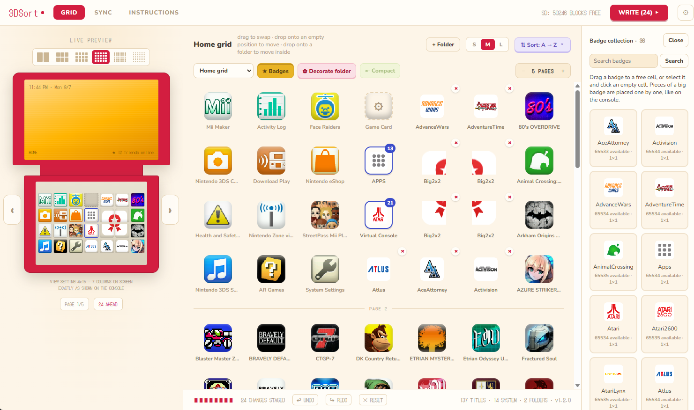
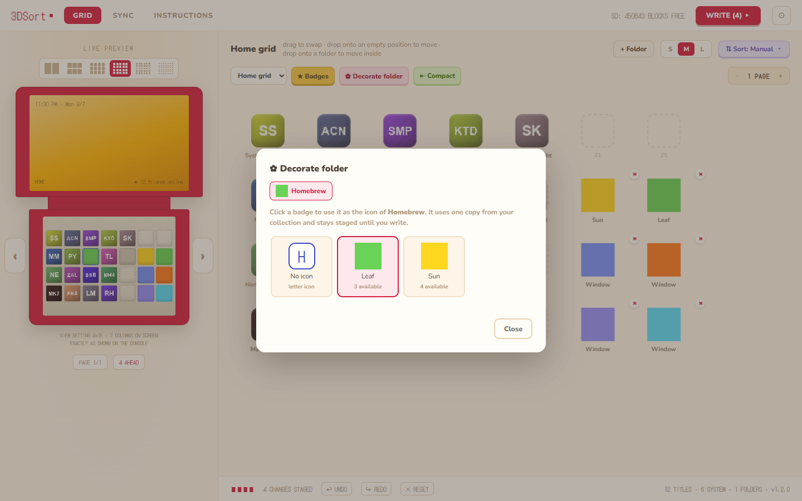
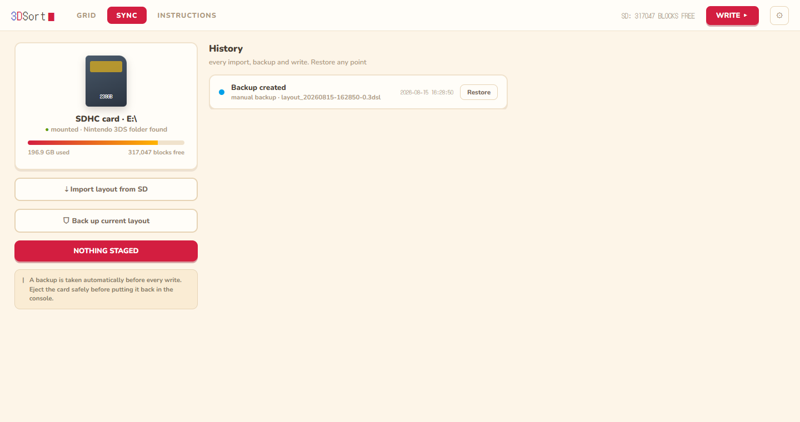

<div align="center">


# 3DSort

**Rearrange your Nintendo 3DS HOME menu from your PC.**

[](#running-from-source)
[](#running-from-source)
[](#tests)
[](#status)
[](LICENSE)
[](https://github.com/SalustLab/3DSort/releases/latest)
[](https://ko-fi.com/salustlab)

**[Download](https://github.com/SalustLab/3DSort/releases/latest)** ·
[What it does](#what-it-does) ·
[What you need](#what-you-need) ·
[Writing to the card](#writing-to-the-card) ·
[Troubleshooting](#troubleshooting) ·
[Running from source](#running-from-source) ·
[How it works](#how-it-works) ·
[Support](#support)

</div>

> [!NOTE]
> **Built with AI assistance.** Much of this code was written with Claude. The
> 3DS file formats were reverse engineered against real dumps, and every write
> path was validated on real consoles before release.

Organizing icons on the console is one stylus drag at a time. 3DSort edits the
layout on the SD card instead: put the card in your computer, drag games,
folders and badges around with a live preview of the console screen, then write
it back and boot the console.

**[Download the latest release](https://github.com/SalustLab/3DSort/releases/latest)**:
a portable `.exe` for Windows, a `.app` for Apple Silicon Macs and a `tar.gz`
for Linux. No installer, no Python.



## What it does

- Drag and drop anything: games, system apps, folders, badges, the Game Card
  slot. Drop one tile on another to swap them, or on an empty cell to move it
- Select many titles at once (Shift-click a range, Ctrl-click or Cmd-click to
  add) and move them together onto a title, an empty cell or a folder
- Sort A to Z, Z to A or by release date, DSiWare and NDS forwarders included
- Create, rename and delete folders, and give them a badge as icon
- Place the badges from your collection on the grid (3DSort does not install
  badges; tools like [GYTB](https://wiki.hacks.guide/wiki/3DS:GYTB) do)
- Live preview of the console screen for every view setting
- Undo, redo and reset. Nothing touches the card until you hit WRITE and
  confirm, and every write takes an automatic, restorable backup first
- Unwraps gift-boxed icons and keeps your HOME menu theme on every write



## What you need

- A 3DS with custom firmware (Luma3DS) and GodMode9
- A PC with an SD card reader. On Windows 10, possibly the
  [WebView2 Runtime](https://go.microsoft.com/fwlink/p/?LinkId=2124703)
  (Windows 11 has it; the app tells you if it is missing)

The first run walks you through the rest: pick the SD card, run the
`3DSort_dump` script the app puts on the card, press verify. That script copies
the console keys (`boot9.bin`, `movable.sed`) and the HOME menu save, so you
never copy them by hand. The INSTRUCTIONS tab keeps the full procedure.

Regions: USA, JPN and EUR are tested on real consoles; CHN, KOR and TWN should
work but have not run on one.

## Writing to the card



Games and badges live on the SD card, so those writes are done when the app
says so. System apps and folders live in a NAND save: after writing, run
`3DSort_inject` in GodMode9. It checks every copy with SHA-256 and aborts
rather than write anything inconsistent.

> [!IMPORTANT]
> Do not boot the HOME menu between writing on the PC and running
> `3DSort_inject`. If you do, the script refuses to run: dump again and retry,
> nothing is lost.

An interrupted write (card pulled, power cut) shows up in SYNC, where you can
complete it or restore the backup.

## Troubleshooting

- **Region-changed console (CTRTransfer):** the card keeps the layout from
  before the change. 3DSort shows both with their contents, suggests the most
  recent one and asks which is yours; only the one you pick is ever written.
  You can change it later in SYNC.
- **"3DSort needs the Microsoft Edge WebView2 Runtime":** install it from the
  link on that screen, then reopen 3DSort.
- **"3DSort could not start" or "Still waiting for 3DSort":**
  [open an issue](https://github.com/SalustLab/3DSort/issues) with the text on
  screen. On Linux, also run `./3DSort` from a terminal and include its output.
- **Old keys:** always let `3DSort_dump` take `movable.sed` from the console. A
  key from an old NAND backup stops working after a format or system transfer.

## Running from source

```
pip install -r requirements-dev.txt
python app.py                                # native window, real SD card
python app.py --serve --mock --mock-badges   # browser, synthetic data
```

### Tests

```
python -m pytest tests -q     # 269 tests, no console needed
```

Tests that need real console keys skip themselves, and a guard test fails if
anything ever writes to a real SD card. `node tools/test_spatial_ui.cjs` and
`node tools/test_multiselect_ui.cjs` drive the UI in a headless browser.

## Building

- **Windows:** `pyinstaller 3DSort.spec`, then `dist\3DSort.exe --selftest`
- **macOS (Apple Silicon):** built by GitHub Actions; not notarized, so
  right-click and Open on first launch (or `xattr -cr 3DSort.app`). From
  source: `tools/build_save3ds_macos.sh`, then `pyinstaller 3DSort.macos.spec`
- **Linux (x86_64):** the release needs glibc 2.39+ and WebKitGTK
  (`sudo apt install gir1.2-webkit2-4.1 libwebkit2gtk-4.1-0`). From source:
  `pip install pywebview[gtk]` and a save3ds built with
  `bash tools/build_save3ds_macos.sh`. See [docs/LINUX_TESTING.md](docs/LINUX_TESTING.md)

## How it works

The HOME menu layout lives in an encrypted archive on the SD card.
[save3ds](https://github.com/wwylele/save3ds) extracts and reimports it with
your console's keys; 3DSort edits `SaveData.dat` and preserves every byte it
does not understand. Folders and system app positions live in `Launcher.dat`
on the NAND, reached through the GodMode9 dump and inject scripts. Badges live
in a third archive, where only the placement table is rewritten.

## Status

Stable for daily use. The full cycle (write, NAND inject,
restore) is validated on two USA New 3DS consoles, on a New 2DS XL from macOS,
and on a JPN-to-USA region-changed console.

## License

[GPL-3.0](LICENSE), the same as [Cthulhu](https://github.com/Ryuzaki-MrL/Cthulhu),
whose bulk unwrap mechanism 3DSort reimplements.

## Credits

- [save3ds](https://github.com/wwylele/save3ds) by wwylele, which handles the
  3DS crypto and filesystem
- [3dbrew](https://www.3dbrew.org/wiki/Home_Menu) for the file format
  documentation
- [Cthulhu](https://github.com/Ryuzaki-MrL/Cthulhu) by Ryuzaki-MrL, which
  showed how the gift-wrap flags work
- [GYTB](https://github.com/MrCheeze/GYTB) by MrCheeze and
  [Simple Badge Injector](https://github.com/AntiMach/simple-badge-injector) by
  AntiMach, which put badges on the test console
- [@appleforever11](https://github.com/appleforever11): macOS support, validated
  on a real New 2DS XL
- [@ratatabananana-bit](https://github.com/ratatabananana-bit): region-changed
  (CTRTransfer) console support, validated on hardware
- [@krazykuzon-hue](https://github.com/krazykuzon-hue): multi-select, and the
  stale dump cache fix

## Support

If 3DSort saved you an afternoon of dragging icons around, you can [buy me a coffee on Ko-fi](https://ko-fi.com/salustlab).

<a href="https://ko-fi.com/salustlab"></a>
