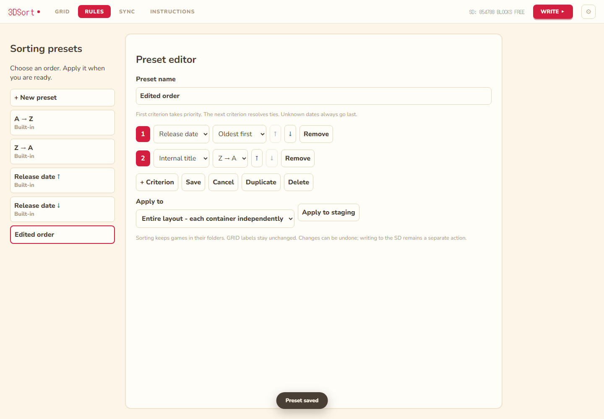

# Sorting presets

Open RULES, choose New preset, give it a name, and add up to three distinct criteria.
Use the numbered rows and arrow buttons to choose priority; each row has its own
direction. Save, choose the entire layout or a named folder, and Apply to staging.
Saved presets also appear in the GRID Sort menu, including inside folders.
Built-ins are read-only; Duplicate starts an editable copy. Save and Delete affect
only the preset library. Apply affects layout staging and supports Undo/Redo.
Sorting never runs automatically and never writes directly to the SD card.

## Comparison and safety

Criteria compare lexicographically: the first unequal criterion decides order.
Names compare case-insensitively using Python lowercase comparison, matching the
existing presets. Missing release dates always follow dated titles, in either
direction; secondary criteria still resolve ties between undated titles. Custom
presets preserve original visual order for complete ties. Built-ins retain their
existing tie order. Each container is independent; global sorting keeps folder
membership. Existing compaction, badge grouping, reserved cells and writable NAND
checks still apply. Sorting may require NAND injection when it actually moves
NAND-owned entries; sorting only SD entries does not itself require injection.
An unchanged layout creates no undo entry.

## Names and sources

Internal title means the existing SMDH short name or TWL banner name. Neither
parsing nor displayed GRID labels changes. Official title means the commercial
`Name` from the existing [3dsdb region feeds](https://hax0kartik.github.io/3dsdb/),
looked up by exact 16-digit Title ID, never by a different region's identifier.
Whitespace is collapsed and Unicode normalized to NFC; commercial punctuation is
preserved. Fallback: exact catalog name, internal name, then hexadecimal Title ID.
DSiWare, NDS forwarders and unknown titles usually use this fallback. Longer SMDH
names are not treated as official catalog names.

The bundled `core/titlenames.json.gz` was generated on 2026-11-09 from
`https://hax0kartik.github.io/3dsdb/jsons/list_{region}.json` in fixed priority
GB, JP, KR, TW, US. First source wins for conflicting exact IDs; within one
source, normalized lowercase lexical name and then exact lexical name decide.
Regional IDs stay distinct. Coverage and upstream naming quality are limited;
this is a community catalog, not a Nintendo-authoritative title database.

Release dates continue to use the existing 3dsdb product-code mapping and
[GameTDB](https://www.gametdb.com/) 3DS and DS catalogs. The existing release-date
table and TWL gamecode lookup are unchanged. Normal application use is offline.

Refresh both catalogs with `python tools/build_titledates.py`, or only names with
`python tools/build_titledates.py --names-only`. To reproduce names without network
access, retain the five source JSON files and run
`python tools/build_titledates.py --names-only --source-dir PATH`.
The pure `title_names` and `write_names` functions accept synthetic parsed feeds;
name JSON ordering and gzip timestamps are deterministic for identical inputs.

## Local storage and testing

Custom presets live in `~/3DSort/sort-presets.json` beside existing settings on
all supported platforms. The version-1 JSON file is separate from SD layouts,
backups, settings.json and undo snapshots. Saves use atomic replacement after
flushing. Invalid or unsupported files show a warning and leave built-ins usable;
the original is preserved as a uniquely named recovery copy before replacement.
Mock mode uses a temporary isolated configuration area, intentionally removed on
process exit; real application configurations persist across launches.

Run `python -m pytest tests -q`, `node tools/test_spatial_ui.cjs`,
`node tools/test_multiselect_ui.cjs`, and `node tools/test_rules_ui.cjs`.
Playwright and Chromium must be installed locally. All UI suites use synthetic
SD data. New catalog resources are included in all three PyInstaller specs.
Native pywebview validation on Windows/macOS/Linux and real-console validation
remain pending. This branch is not a release-readiness claim.
