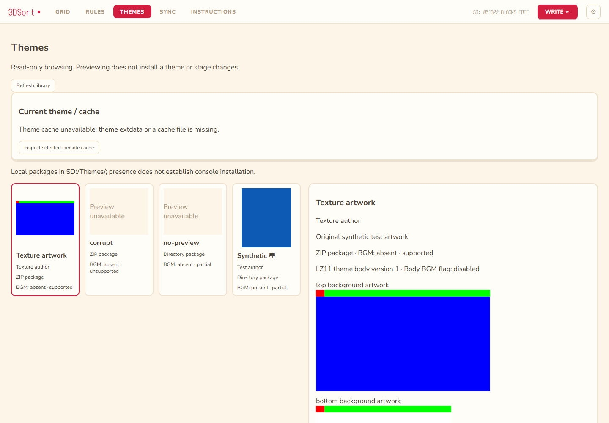

# Read-only theme browsing

THEMES browses local packages from the selected SD root's `Themes` directory.
Previewing never installs, activates, deletes, stages or writes theme data.
The existing GRID preview keeps its existing presentation; selecting a library
card only opens its details. Badges remain in the production GRID badge panel.

## Storage and capability assessment

These are three independent sources, not one theme catalog:

| Source | Reliable information | Limitations |
| --- | --- | --- |
| HOME `user/SaveData.dat`, `0x13B8` onward | Existing preservation boundary | Not a theme body; this feature does not interpret or modify the tail |
| Separate theme extdata | Declared body/BGM lengths, declared shuffle cache slots, supported cached background artwork | Cache content does not establish active identity or a complete installed Nintendo theme catalog |
| `SD:/Themes/` directories and ZIPs | Package files, SMDH metadata, BGM file presence, supplied previews, supported body artwork | A local package does not prove installation or activation |

References inspected before parser implementation:

- [3dbrew HOME Menu](https://www.3dbrew.org/wiki/Home_Menu), including
  `ThemeManage.bin`, caches and shuffle storage.
- [3dbrew theme body format](https://www.3dbrew.org/wiki/Home_Menu/Themes).
- [Anemone3DS](https://github.com/astronautlevel2/Anemone3DS), inspected commit
  `a0118a0dd09617f963e168555c3e9615375207c7`: `source/fs.c`, `source/loading.c`, `source/themes.c`,
  `include/themes.h`. Used as behavioral reference, not copied implementation.
- [Usagi Theme Editor](https://github.com/usagirei/3DS-Theme-Editor), inspected
  commit `da1ac2d19961a0f891a8e32c78f81604efc9733c`: `ThemeEditor.Common/Graphics/RawTexture.cs` and
  `Themes/Theme.cs`, corroborating RGB565 tiling, orientation and frame sizes.

Regional theme extdata low IDs explicitly supported by Anemone's region switch:

| Region | Theme extdata ID |
| --- | --- |
| JPN | `000002cc` |
| USA | `000002cd` |
| EUR | `000002ce` |
| KOR | `000002cf` |

CHN/TWN are unsupported for cache inspection; no IDs are extrapolated. These
are separate from HOME layout extdata IDs. KOR support here is a source mapping,
not a hardware-validation claim.

Theme extdata has an `icon`, `boss/` and `user/` filesystem. `ThemeManage.bin`
is 0x800 bytes: body length at 0x8, BGM length at 0xC, ten shuffle body lengths
at 0x338 and ten shuffle BGM lengths at 0x360. Unknown bytes are ignored. The
first word is **not treated as a version or magic**: newer HOME documentation
describes a prompt-handled flag in its first byte. Anemone's historical struct
labels several fields unknown and must not be used to invent field meanings.

`BodyCache.bin` holds a compressed body payload in a padded 0x150000-byte cache;
`BgmCache.bin` can be padded to 0x337000. Shuffle uses `BodyCache_rd.bin` with
ten 0x150000-byte slots and separate `BgmCache_00.bin` through `BgmCache_09.bin`.
Only declared shuffle lengths/count are reported in this phase; shuffle artwork
and selection order are not interpreted. Regular body artwork is decoded only
within the manager's validated payload length. Missing/truncated caches and
invalid lengths produce an unavailable reason. BGM length is checked against
its cache file when nonzero, without playing or decoding audio.

## Packages, metadata and previews

Discovery supports immediate child directories and `.zip` files (case-insensitive)
under `SD:/Themes/`. ZIPs may contain the package at the root or in one enclosing
directory: exactly one `body_LZ.bin` is required. Only files alongside that body
are used. Directory packages require `body_LZ.bin` at their root. Unrelated root
files are ignored; incomplete directories and invalid ZIPs get individual feedback.
Optional files are `info.smdh`, `bgm.bcstm`, `preview.png`, `preview.jpg` and
`preview.jpeg`, matched case-insensitively. Arbitrary text/JSON metadata and
multi-theme ZIP bundles are unsupported.

SMDH must have `SMDH` magic, size 0x36C0 and version 0. Name, description and
author use the English slot, then Japanese, then the first populated language.
Strings are bounded UTF-16LE; invalid metadata produces a warning and the package
filename remains the fallback label. Duplicate display names retain distinct
opaque IDs. Filenames never identify the active theme. BGM presence and the
body's BGM-enable flag are distinct; file presence does not validate the audio.

Preview priority is a decoded, validated package PNG/JPEG, then decoded body
background artwork, then **Preview unavailable**. Invalid supplied images produce
a warning and allow body artwork fallback. Package images are labeled supplied
previews whose fidelity has not been checked against the body.

Body support is Nintendo LZ11 compression, decompressed version 1, with a minimum
0xC4-byte header. The parser validates output size, truncation, each back-reference,
screen draw/frame types and documented enabled color/texture block boundaries.
It does not parse or render embedded sound effects; only their section boundary
is checked. Unknown fields are not interpreted. This is an inspection parser,
not an installation validator or serializer.

The decoder supports little-endian RGB565 in 8x8 Morton tiles. It preserves x/y
orientation and screen assignment. Non-scrolling artwork uses 512x256 textures,
cropped to 412x240 (top) or 320x240 (bottom). Scrolling textures use 1024x256,
cropped to the documented 1008x240 artwork. Bottom flipbook types 2/4 display the
960x240 strip containing three 320x240 frames. These are labeled **background
artwork**, not a simulated console viewport. No animation/scroll position,
stereoscopy, HOME overlays, folders, borders, colored backgrounds, gradients or
A8 moving-square effects are rendered. Color/effect themes may still have a valid
supplied preview. Unsupported frame modes produce a limitation; malformed known
references reject the body. Supported means supported background decoding only.

## Cache identity, isolation and preservation

The current-theme section always reports identity as **unknown**. It never matches
a package by filename, visual similarity or cache hash. Cache contents can be
stale or refer to shuffle members. Built-ins and Nintendo DLC titles/names are
not extracted or enumerated.

Inspection is explicit and uses the already selected console, existing local
keys and regional theme extdata ID. It does not call `import_sd` (which has its
own SD setup-script behavior). The native extractor opens the theme archive
with `--readonly --extract` into an OS temporary directory outside the SD and
removes it afterward. No theme archive import is exposed. Missing keys/extdata,
redirected paths, mismatched console identity and ambiguous id1 trees fail closed.
The existing native helper cannot select a particular id1 explicitly; inspection
therefore refuses multiple eligible trees rather than assuming one is active.

No `SaveData`, `Staging`, backup, write or recovery code is invoked by theme
discovery/parsing. `SaveData.graft_tail()` is unchanged: layout writes still graft
the fresh card's complete theme/shuffle tail, including its length. Both 0x2DA0
and 0x2CB0 SaveData sizes retain their existing contracts. Ordinary application
setup/layout operations retain their own documented write behavior; this feature
does not change those operations.

Future bank integration should supply the active bank's selected filesystem tree
and identity to this reader. Package IDs/caches must be invalidated when that
source changes. No shared-bank or permanent-root semantics are assumed here.

## Security and performance

- Frontend IDs are random, server-issued and scoped to one discovery/root. They
  cannot select arbitrary filesystem paths. Refresh invalidates old IDs/results;
  tab entry refreshes the source. No new SD file-serving HTTP route is added.
- Package reads reject symlinks and Windows reparse points in path components.
  ZIP names reject traversal, absolute/drive/backslash/NUL paths, duplicate names,
  redirected/special entries and encrypted archives. Archives are never extracted.
- Limits: 1000 packages, 128 entries per package/archive, 8 MiB per member,
  32 MiB archive/aggregate content, compression ratio at most 200:1. ZIP central
  directories are bounded before allocating member objects; ZIP64 is unsupported.
- LZ11 output is capped at 0x150000 before allocation. Image inputs must be PNG or
  JPEG, at most 4096 per axis and 4 million pixels. Images are re-encoded to PNG
  data URLs, with metadata removed, and limited to 1008x960 for details.
- Cache source traversal is limited to 512 entries and 64 MiB before extraction.
  Extracted files are read with individual size limits.
- Cards load lazily as visible, one inspection request at a time, with small
  thumbnails. The backend retains at most 24 parsed results; the frontend retains
  card summaries/thumbnails and one full detail view. No framework or new runtime
  dependency is added; Pillow and the standard library provide decoding/ZIP I/O.
- Individual failures remain local to a package. Refresh rereads changed media.
  As with other local file browsing, do not concurrently replace/mutate the SD
  filesystem while it is being inspected.

## Validation

Synthetic assets in `tools/theme_fixtures.py` are original generated test data.
No Nintendo theme content, personal dumps or third-party assets are bundled.

`tests/test_themes.py` covers discovery, Unicode/duplicate metadata, optional files,
SMDH/LZ11 boundaries, all supported texture frame sizes and asymmetric pixel
orientation, ZIP traversal/links/limits, image dimensions, filesystem failures,
cache parsing/isolation, both SaveData sizes and byte/staging preservation.
`tools/test_themes_ui.cjs` exercises actual Python fixture discovery and parsing,
displayed metadata/BGM, image pixels and dimensions, selection, corrupt/missing
previews, empty source feedback, cache errors and unchanged GRID/RULES/staging.

Validation evidence on Windows, Python 3.13 and headless Chromium:

- `python -m pytest tests -q`: 354 passed, 9 skipped (final full run); 42 theme tests passed again after audit fixes.
- `node tools/test_spatial_ui.cjs`: passed.
- `node tools/test_multiselect_ui.cjs`: passed.
- `node tools/test_rules_ui.cjs`: passed.
- `node tools/test_themes_ui.cjs`: passed.
- `python app.py --selftest`: all six bundled resource checks passed.

Earlier full runs had transient Windows directory-cleanup errors in existing
interrupted-write payload recovery and mock-tree exit cleanup tests while browser
checks were running concurrently. A combined theme/spatial API run passed all 95
tests. Final validation ran pytest separately from browser processes. No native WebView2/WebKitGTK, physical console, actual
encrypted theme extdata or macOS/Linux runtime validation was performed here.
Texture accuracy evidence is synthetic pixel testing and comparison to documented
layout/source algorithms; it is not a claim of 1:1 console rendering.

## Requirements before installation

A separate installation phase needs validated cache/shuffle synchronization with
the HOME tail, explicit console/tree identity, backup and stale-data checks for
every affected archive, crash recovery across archives, write verification,
hardware acceptance, and licensing/asset handling. Existing layout-write safety
alone is not proof of a safe theme installer. This phase provides no installation,
deletion, serialization, shuffle activation, audio playback, downloads or bank
integration APIs.
